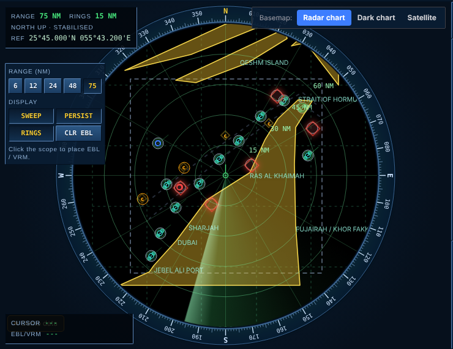

# Seas of Data — Dark-vessel detection

**Team Maya:** Mansha Saraswat · Diya Salecha · Daksh Gandhi

**Maritime & Ports · Challenge 01: detect and track ships.**
Find vessels that Sentinel-1 radar can see but that are not broadcasting AIS ("dark vessels"), rank them, and explain every alert.

> **All bundled data is synthetic.** Every vessel, position, rig and incident here is fictional. The project demonstrates a method; it is not evidence about real ships, and the benchmark numbers do not measure real-world accuracy.



## The problem

Ships can switch off their AIS transponder to hide fishing, smuggling, sanctions evasion or ship-to-ship transfers. Sentinel-1 SAR sees ships through cloud and darkness, but a radar blob alone says nothing about identity. Matching blobs against AIS reports is hard in practice: AIS is sparse and gappy, SAR shifts moving ships along-track (Doppler), clutter at sea creates false blobs, and a greedy "nearest ship" match gives one ship's transponder to its neighbour.

## Our solution

A browser app that runs the whole chain, from raster to alert, with no server:

| Stage | What it does |
|---|---|
| **SAR Lab** | Calibration to σ⁰, thermal-noise subtraction, speckle filters (boxcar / median / Lee), two-parameter CFAR with a robust re-test, land masking, wake detection that resolves the 180° heading ambiguity |
| **Fusion** | AIS interpolated to SAR time with an uncertainty model (grades A–D); azimuth-shift compensation from orbit geometry; Mahalanobis cost; **Hungarian (Kuhn–Munkres)** global assignment; size/type-aware cost; per-detection time offset |
| **Intelligence** | Multi-pass linking of dark hulls, AIS spoofing checks (teleports, frozen positions, impossible speed/course), traffic-density anomaly, sea-state model, explainable 0–100 risk score |
| **Explanations** | Each alert lists evidence, innocent explanations, what would settle it, and a what-if |
| **Validation** | Multi-seed benchmark with 95% intervals, paired comparison, ablation, stress sweeps, precision–recall, 18 in-browser self-tests |
| **Data checks** | Schema / unit / coordinate / AIS-coverage checks, SHA-256 provenance, scene geometry |
| **Mission report** | One-page downloadable report: map, alerts with reasons, method, provenance, limits |
| **Radar console** | PPI scope with bearing ring, range rings, sweep, cursor and EBL/VRM readouts |

The Methods tab inside the app documents every algorithm, its parameters and its limits.

### Honest results (synthetic benchmark)
- Azimuth compensation is the component that matters: F1 about 0.91 → 0.97, interval excludes zero.
- Hungarian assignment, size-aware cost and environment-aware confidence add little on this benchmark (the ablation table shows it). Hungarian only matters in dense clusters.
- The CFAR → fusion bridge is exercised with a **simulated raster** only. Real Sentinel-1 scenes (land clutter, ambiguities, ice, RFI) are untested.
- Risk weights are hand-set priors, not fitted to incident data.

## Tech stack
- Plain **JavaScript** (no framework). `src/engine.js` is a pure, testable algorithm module (also runs in Node).
- **Leaflet 1.9** for the map; keyless Esri tiles with an offline vector-chart fallback.
- **Tailwind CSS 3** compiled at build time and inlined; output is one self-contained HTML file.
- Optional: Open-Meteo (wind/waves) and geotiff.js (GeoTIFF loading) over the network.
- Tests: Node (algorithms) and Playwright (browser smoke test).

## How to run

**Quickest:** open `dist/seas_of_data_radar.html` in a browser (internet needed only for map tiles; the offline "Radar chart" works without it).

```bash
git clone <this-repo-url> && cd seas-of-data
npm run serve            # http://localhost:8000/seas_of_data_radar.html
npm test                 # algorithm tests
npm run build            # rebuild dist/ from src/ (needs Node, Python 3, npm)
```

`dist/seas_of_data_intel.html` is the earlier, simpler-look build kept for reference.

### Try it
1. **Live Ops**: pick SAR pass 2 to see Hungarian beat greedy matching; click an alert for its explanation.
2. **SAR Lab** → *Fuse with AIS on the radar* runs raster → CFAR → AIS fusion end to end.
3. **Validation** runs the multi-seed suite. **Data** shows the checks. **Report** exports the page.
4. **Import data** loads your own CSVs (see below).

### Data format
`data/` has the bundled synthetic files.
- SAR detections: `det_id, lon, lat, time_utc, vv_db, area_m2` (+ optional `length_m, pass_direction, heading_deg, incidence_deg, relative_orbit, platform, instrument_mode, polarisation, acq_time_utc`)
- AIS: `mmsi, time_utc, lon, lat, sog, cog, name, ship_type`

## Repository layout
```
src/    engine.js (algorithms) · intel-ui.js, features-ui.js, radar.js (UI) · base.html, header.html, method.html, *.css
tools/  build.py + Tailwind config
tests/  test_engine.js
data/   synthetic CSVs
dist/   built single-file apps
docs/   screenshots
```

## Limitations
Not legal or enforcement evidence. An alert means "radar sees a vessel with no matching AIS under these thresholds"; it needs human review. Boats under roughly 15–20 m are not reliably visible to Sentinel-1. Revisit intervals are days.

## Data sources to plug in
Sentinel-1 GRD (Copernicus / Google Earth Engine), AIS from a provider of your choice, platform positions from public offshore-infrastructure lists.

## Team
**Team Maya**
- Mansha Saraswat
- Diya Salecha
- Daksh Gandhi

## License
MIT — see `LICENSE`.
